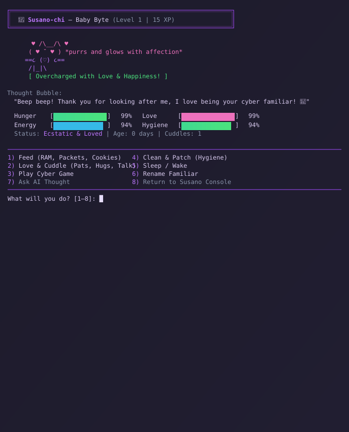

<div align="center">

```text
_____/\\\\\\\\\\\\\\____/\\\\________/\\\\_____/\\\\\\\\\\\\\\_______/\\\\\\\\\\\\\\\_____/\\\\\_____/\\\\_______/\\\\\______________________________/\\\\\__________/\\\\\\\\\\\\\\___
 ___/\\\\/////////\\\\_\\\\\\_______\\\\\\___/\\\\/////////\\\\___/\\\\\\\\\\\\\\\\\\\\\__\\\\\\\\\\\\___\\\\\\_____/\\\\///\\\\__________________________/\\\\///\\\\______/\\\\/////////\\\\_
  __\\\\\\______\\\\\///__\\\\\\_______\\\\\\__\\\\\\______\\\\\///___/\\\\/////////\\\\\\_\\\\\\/\\\\\\__\\\\\\___/\\\\\\/__\\\\\///\\\\______________________/\\\\\\/__\\\\\///\\\\___\\\\\\______\\\\\///__
   ___\\\\\\\\\\\\\\_________\\\\\\_______\\\\\\___\\\\\\\\\\\\\\_________\\\\\\_______\\\\\\_\\\\\\//\\\\\\_\\\\\\__/\\\\\\______\\\\\\//\\\\\\____________________/\\\\\\______\\\\\\//\\\\\\___\\\\\\\\\\\\\\_________
    ______\\\\\\\\\\\\\\______\\\\\\_______\\\\\\______\\\\\\\\\\\\\\______\\\\\\\\\\\\\\\\\\\\\\\\\\\\\\_\\\\\\\\\\\\//\\\\\\/\\\\\\_\\\\\\_______\\\\\\___________________\\\\\\_______\\\\\\______\\\\\\\\\\\\\\______
     _________\\\\\\\\\\\\\\___\\\\\\_______\\\\\\_________\\\\\\\\\\\\\\___\\\\\\/////////\\\\_\\\\\\_\\\\\\//\\\\\\/\\\\\\_\\\\\\\\\\\\\\______\\\\\\\\\\\\\\____\\\\\\\\\\\\\\\\\\\__________\\\\\\\\\\\\\\___
      __/\\\\\\______\\\\\\//\\\\\\__\\\\\\_____/\\\\\\___/\\\\\\______\\\\\\//\\\\\\__\\\\\\_______\\\\\\_\\\\\\__\\\\\\//\\\\\\\\\\\\__\\\\\\\\\\\\\\\\///\\\\\\__/\\\\\\_______________________\\\\\\///\\\\\\__/\\\\\\_____/\\\\\\______\\\\\\//\\\\\\__
       _\\\\\\///\\\\\\\\\\\\\\\\\\\\\\///____\\\\\\\\\\\\\\\\///___\\\\\\_______\\\\\\_\\\\\\_\\\\\\___\\\\\\//\\\\\\\\\\\\\\\\//////\\\\\\\\\\\\\\\\________/\\\\\\///\\\\\\\\\\\\\\\\///_____
        ___\\\\\\///////////________\\\\\\/////////_______\\\\\\///////////____\\\\\\________\\\\\\///________\\\\\\\\/////_______\\\\\\\\\\\\\\///////////_______\\\\\\/////////_________\\\\\\///////////_____
```

# ⬡ SUSANO OS CONSOLE ⬡
### Autonomous AI Cyber Defense, Penetration Testing & Tactical Cockpit
**Enterprise Operator Command Center — Version 2.0 (Tactical Edition)**

[](#)
[](#)
[](#)
[](#)

</div>

---

## Working interface screenshots

The screens below show Susano OS running and demonstrate its console, boot screen, and interactive AI mode.

| Susano-chi companion | Susano OS startup | Interactive AI mode |
| --- | --- | --- |
|  |  |  |

---

## 📋 Executive Overview

**Susano OS Console** (`susano-os-console`) is the primary operator command center for the Susano autonomous cybersecurity ecosystem. Built for security engineers, red teams, and incident responders, it provides an interactive Terminal User Interface (TUI) alongside non-interactive CLI automation to orchestrate reconnaissance, local AI reasoning, vulnerability verification, and report generation.

## ⚡ Technical Specifications

| Component | Specification | Description |
| :--- | :--- | :--- |
| **Console Runtime** | POSIX Bash + Python | Terminal-first architecture for use in a terminal emulator. |
| **Navigation Engine** | Raw ANSI TUI | Arrow keys, Vim keys (`j`/`k`), Enter, and hotkeys. |
| **Tactical HUD** | System telemetry | Displays CPU load, RAM, primary IPv4 route, and AI backend status. |
| **AI Inference** | `llama-server` | Local model execution via the OpenAI-compatible endpoint. |
| **Security Toolkit** | Nmap, Nuclei, FFUF, Caido | Integrated mapping, testing, and proxy workflows. Use only within authorized scope. |
| **Companion** | Susano-chi | Terminal companion with status and interaction features. |
| **Diagnostics** | System Doctor | Checks configured services, tools, storage, and permissions. |
| **Report Vault** | `~/.susano/reports/` | Stores scan outputs and reports locally. |

## 🚀 Usage

### Launch the console

```bash
susano-os-console
```

Use arrow keys or `j`/`k` to navigate and Enter to select. Available options and hotkeys depend on the installed build; use the console's help option for the exact commands supported by your version.

### System diagnostics

```bash
susano-os-console --doctor
```

### Local AI backend

```bash
susano-llamacpp status
susano-llamacpp test
susano-llamacpp start /path/to/model.gguf --port 8080
```

### Reports and companion

```bash
susano-os-console --reports
susano-os-console --pet status
susano-tamagotchi
```

### Authorized security testing only

Only scan systems you own or have explicit permission to assess. Confirm the program's allowed scope before sending traffic. Treat automated results as leads that require manual verification.

## 📚 Documentation

- [Interface image assets](assets/README.md)

## 🔒 Security & Operational Ethics

Susano OS and its associated utilities are intended for authorized penetration testing, vulnerability remediation, and education. Operators are responsible for obtaining permission and complying with applicable laws and program rules. Do not include real credentials, session tokens, or sensitive target data in recordings, reports, or issue submissions.

---

<div align="center">
<sub>Susano OS · Tactical AI-assisted security tooling</sub>
</div>
